# Knowledge Graph — Orchestra

Questo documento mappa i cluster del grafo di conoscenza e le connessioni tra gli artefatti Kiro.
Generato da `kirograph docs toc` + analisi manuale delle relazioni cross-documento.

---

## Cluster del grafo

Il grafo è organizzato in **5 cluster** per responsabilità. Gli edge mostrano da quale artefatto ogni nodo dipende o a quale risponde.

```mermaid
graph TD
  subgraph DOMAIN ["🎯 Domain Knowledge"]
    DM[domain-model.md]
    GR[game-rules.md]
    GL[domain-glossary.md]
    SM[state-machine.md]
  end

  subgraph SCORING ["📊 Scoring & Invariants"]
    SI[scoring-invariants.md]
    TS[testing-strategy.md]
    ADR[architecture-decisions.md]
  end

  subgraph CONTEXT ["🧭 Kiro Steering"]
    PR[product.md]
    AR[architecture.md]
    CS[coding-standards.md]
    SEC[security.md]
    TECH[tech.md]
    ST[structure.md]
  end

  subgraph SKILLS ["🛠 Skills"]
    AGR[add-game-rule]
    IGT[implement-game-transition]
    RSR[review-scoring-rules]
    SDD[SDD Skills — Addy Osmani]
  end

  subgraph HOOKS ["⚡ Hooks"]
    HK_DI[domain-integrity]
    HK_ST[scoring-tests]
    HK_SM[state-machine-tests]
    HK_DS[documentation-sync]
    HK_KG[kirograph-sync]
  end

  subgraph RUNTIME ["⚙️ Code — Boilerplate"]
    APP[app/]
    COMP[components/ui/]
    LIB[lib/utils.ts]
    API[app/api/health/]
  end

  %% Domain -> Scoring
  GR -->|"10 invarianti"| SI
  GR -->|"casi limite"| TS
  SM -->|"fasi del turno"| TS
  SM -->|"transizioni"| ADR

  %% Domain -> Context (steering dipende dal dominio)
  DM -->|"entità"| AR
  DM -->|"glossario"| GL
  GR -->|"fonte autorevole"| PR
  GR -->|"naming"| CS

  %% Domain -> Skills
  GR -->|"precondizioni"| AGR
  SM -->|"transizioni"| IGT
  SI -->|"matrice test"| RSR

  %% Hooks -> artefatti che guardano
  HK_DI -->|"PostFileSave lib/domain"| GR
  HK_ST -->|"PostFileSave ScoringEngine"| SI
  HK_SM -->|"PostFileSave StateMachine"| SM
  HK_DS -->|"PostFileSave game-rules"| TS
  HK_DS -->|"PostFileSave game-rules"| SI
  HK_KG -->|"Stop trigger"| ADR

  %% Skills -> documenti che leggono
  AGR -->|"legge"| GR
  AGR -->|"aggiorna"| TS
  IGT -->|"legge"| SM
  RSR -->|"legge"| SI
  RSR -->|"aggiorna"| ADR
  SDD -->|"framework"| AGR
  SDD -->|"framework"| IGT

  %% Context -> Runtime (futuro)
  AR -->|"guida"| APP
  CS -->|"guida"| LIB
  SEC -->|"vincola"| API
  TECH -->|"stack"| APP
```



---

## Cluster 1 — Domain Knowledge

Nodi centrali del grafo. Tutto il resto dipende da questi.

| Nodo | Sezioni indicizzate da KiroGraph | Connessioni in uscita |
|------|----------------------------------|----------------------|
| `game-rules.md` | Invarianti (×10), tabella punteggi, casi limite, fasi | → scoring-invariants, testing-strategy, product, add-game-rule |
| `domain-model.md` | Entità (×9), relazioni, stati, invarianti del modello | → architecture, domain-glossary |
| `state-machine.md` | 5 fasi, diagramma Mermaid, tabella azioni non valide, timeout | → testing-strategy, implement-game-transition, ADR |
| `domain-glossary.md` | 26 termini univoci | ← domain-model (fonte) |

---

## Cluster 2 — Scoring & Invariants

| Nodo | Sezioni indicizzate | Connessioni |
|------|---------------------|-------------|
| `scoring-invariants.md` | SCORE-INV-1…10, tabella combinatoria, ambiguità aperte | ← game-rules; → testing-strategy, ADR |
| `testing-strategy.md` | INV-1…10 test, EDGE-1…7, tabella punteggi | ← game-rules, state-machine; → hooks |
| `architecture-decisions.md` | ADR-001…004, OPEN-001…003 | ← state-machine, scoring-invariants; → skills |

---

## Cluster 3 — Kiro Steering

Letti da Kiro ad **ogni conversazione** (frontmatter `inclusion: always`).

| Nodo | Responsabilità | Dipende da |
|------|---------------|------------|
| `product.md` | Visione, utenti, flusso, regole non negoziabili | ← game-rules |
| `architecture.md` | Stack, struttura, WebSocket events, componenti | ← domain-model |
| `security.md` | Scoring server-side, ruoli, idempotenza | ← game-rules (INV-6,8,9) |
| `coding-standards.md` | Naming, pattern stato, error codes | ← domain-model (naming entità) |
| `testing-strategy.md` | Specifica test per invariante | ← game-rules, state-machine |
| `tech.md` | Stack, comandi, vincoli | — |
| `structure.md` | Layout repo, routing, naming file | ← architecture |

---

## Cluster 4 — Skills

Procedure operative che Kiro attiva su richiesta.

| Skill | Attivazione | Legge | Aggiorna |
|-------|-------------|-------|---------|
| `add-game-rule` | "Aggiungi / modifica una regola" | game-rules, domain-model | game-rules, testing-strategy, ADR |
| `implement-game-transition` | "Implementa una transizione" | state-machine, game-rules | state-machine, ADR |
| `review-scoring-rules` | "Verifica il punteggio" | scoring-invariants, testing-strategy | testing-strategy, ADR |
| SDD — planning-and-task-breakdown | "Pianifica l'implementazione" | spec | tasks |
| SDD — incremental-implementation | "Implementa in step" | tasks | codice |
| SDD — code-review-and-quality | "Rivedi le modifiche" | codice | — |

---

## Cluster 5 — Hooks

Controlli automatici che non richiedono attivazione manuale.

| Hook | Trigger | Guarda | Prodotto |
|------|---------|--------|---------|
| `domain-integrity` | PostFileSave `lib/domain/`, `lib/engine/` | game-rules.md (invarianti) | Report discrepanze |
| `scoring-tests` | PostFileSave `ScoringEngine.ts` | scoring-invariants.md | Esito test unitari |
| `state-machine-tests` | PostFileSave `StateMachine.ts`, `GameRulesValidator.ts` | state-machine.md | Esito test transizioni |
| `documentation-sync` | PostFileSave `game-rules.md` | testing-strategy.md, scoring-invariants.md | Lista documenti da aggiornare |
| `kirograph-sync` | Stop (fine sessione agente) | tutto il repo | Grafo KiroGraph aggiornato |

---

## Edge critici (connessioni tra cluster)

Questi sono i percorsi più importanti del grafo — dove una modifica in un nodo si propaga agli altri.

| Modifica a | Si propaga a | Via |
|-----------|-------------|-----|
| `game-rules.md` | `scoring-invariants.md` | edge diretto (fonte → derivato) |
| `game-rules.md` | `testing-strategy.md` | edge diretto (invarianti → test) |
| `game-rules.md` | `product.md` | steering linka game-rules come fonte |
| `state-machine.md` | `implement-game-transition` skill | skill legge state-machine prima di operare |
| `ScoringEngine.ts` (futuro) | `scoring-tests` hook | PostFileSave automatico |
| `StateMachine.ts` (futuro) | `state-machine-tests` hook | PostFileSave automatico |
| `lib/domain/*.ts` (futuro) | `domain-integrity` hook | PostFileSave automatico |

---

## Stato attuale del grafo (da `kirograph status`)

```
File indicizzati:    12  (boilerplate Next.js + configurazione)
Simboli:            64
Edge:               40
Doc sezioni:        ~90  (DESIGN.md, README, docs/×4, PRD)
Cluster attivi:      5  (Domain, Scoring, Steering, Skills, Hooks)
Edge cross-cluster:  0  (il codice di dominio non esiste ancora)
```

> **Nota:** I 40 edge attuali sono tutti interni al codice boilerplate (Next.js config, tsconfig, package.json).
> Gli edge cross-cluster si materializzeranno quando i moduli `lib/domain/`, `lib/engine/` e `lib/validation/` saranno creati.
> Il grafo è già predisposto: tutti i nodi documentali sono indicizzati e collegabili.
