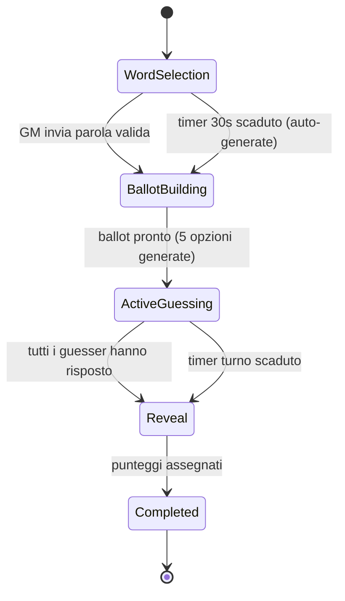

# State Machine — Orchestra Turn Lifecycle

## Diagramma degli stati

## Descrizione delle fasi

### WordSelection
- **Chi agisce:** Game Master
- **Azione:** Digita una parola; il sistema la valida in tempo reale (DictionaryClient).
- **Timeout:** 30 secondi. Allo scadere, WordAutoGenerator genera una parola valida e il turno avanza automaticamente.
- **Transizione:** GM invia parola valida OPPURE timeout -> BallotBuilding.

### BallotBuilding
- **Chi agisce:** Sistema
- **Azione:** TranslationClient ottiene la traduzione corretta. FakeOptionGenerator costruisce le 4 opzioni false. Il ballot (5 opzioni) viene inviato ai client via WebSocket (ballot:revealed).
- **Durata:** sub-secondo (asincrono, non input utente).
- **Transizione:** automatica -> ActiveGuessing.

### ActiveGuessing
- **Chi agisce:** Tutti i Player (escluso GM del turno)
- **Azione:** Ciascun giocatore sceglie una delle 5 opzioni. La risposta sbagliata blocca il giocatore per il resto del turno.
- **Timeout:** configurato dall'host (default 60 secondi). Allo scadere, il turno avanza con le risposte pervenute.
- **Transizione:** tutti hanno risposto OPPURE timer scaduto -> Reveal.

### Reveal
- **Chi agisce:** Sistema
- **Azione:** Il server emette turn:revealed con la risposta corretta e i punteggi calcolati (server-side).
- **Durata:** istantanea.
- **Transizione:** automatica -> Completed.

### Completed
- **Stato finale del turno.**
- I punteggi sono immutabili.
- Il sistema avanza al turno successivo (NextTurn) o al podio (ultima manche dell'ultimo round).

## Azioni non valide per fase

| Azione | Fase valida | Comportamento fuori fase |
|--------|------------|--------------------------|
| Inviare parola | WordSelection | GameRuleViolationError(WRONG_PHASE) |
| Rispondere al ballot | ActiveGuessing | GameRuleViolationError(WRONG_PHASE) |
| Rispondere dopo lock | -- | GameRuleViolationError(ALREADY_LOCKED) |
| GM risponde | -- | GameRuleViolationError(NOT_A_GUESSER) |
| Risposta post-timer | -- | GameRuleViolationError(TURN_EXPIRED) |

## Transizioni automatiche (timeout)

| Fase | Durata | Trigger automatico |
|------|--------|-------------------|
| WordSelection | 30 secondi | WordAutoGenerator -> BallotBuilding |
| ActiveGuessing | [timer host] | Reveal con risposte pervenute |
